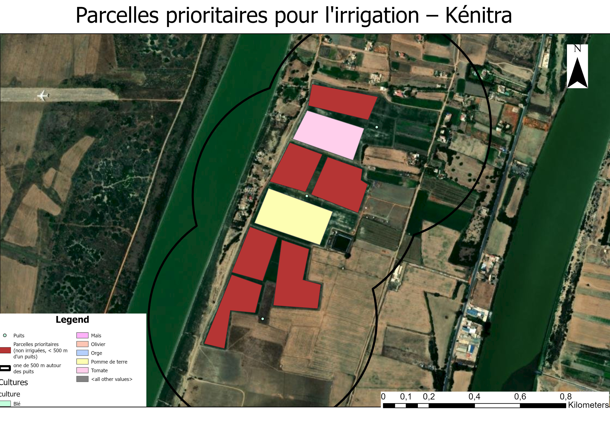
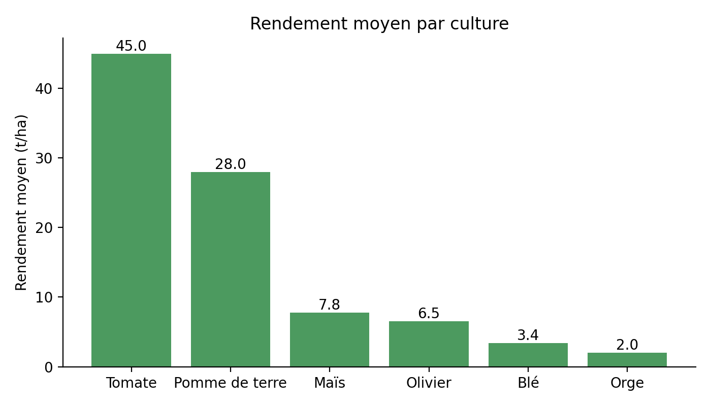
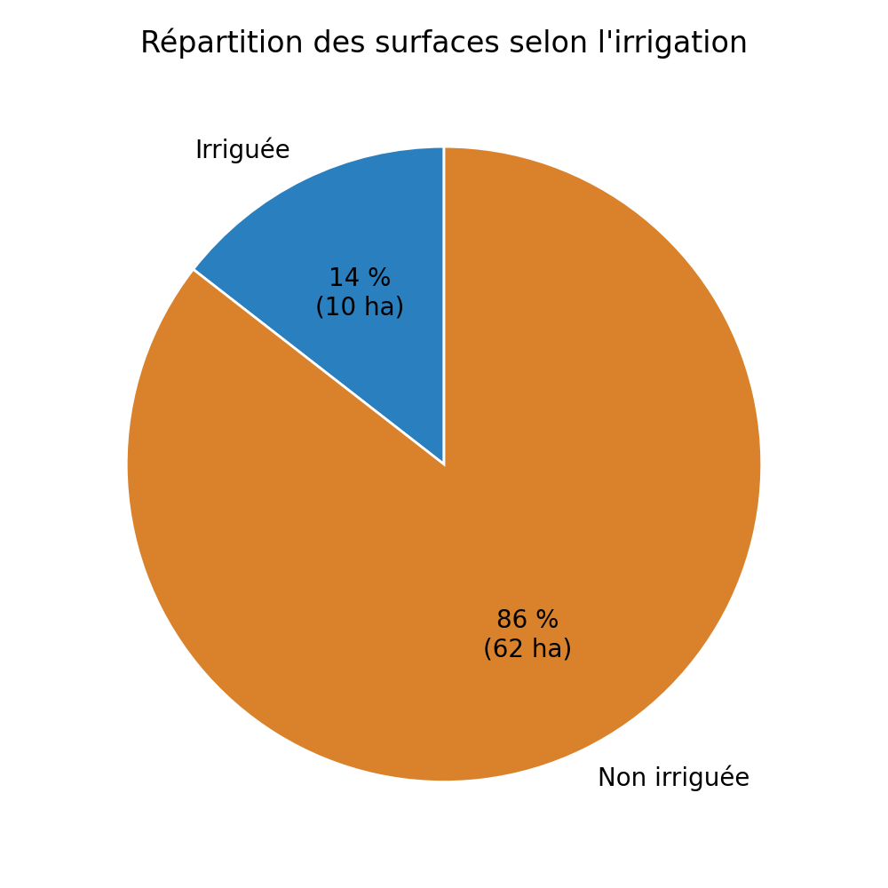
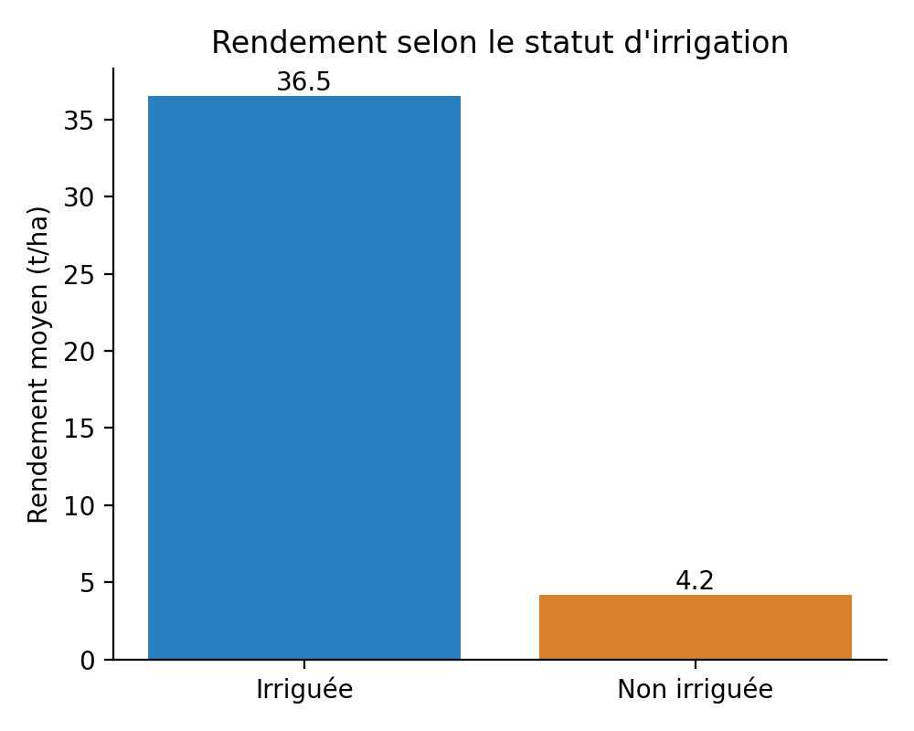

# Identification des parcelles agricoles non irriguées prioritaires à proximité des puits

**Analyse spatiale multicritère (SQL + SIG) – Région de Kénitra, Maroc**


---

## Sommaire

1. [Contexte et problématique](#1-contexte-et-problématique)
2. [Objectifs](#2-objectifs)
3. [Données](#3-données)
4. [Méthodologie](#4-méthodologie)
5. [Résultats](#5-résultats)
6. [Discussion et limites](#6-discussion-et-limites)
7. [Perspectives](#7-perspectives)
8. [Structure du dépôt](#8-structure-du-dépôt)
9. [Reproduire l'analyse](#9-reproduire-lanalyse)
10. [Auteur et licence](#10-auteur-et-licence)

---

## 1. Contexte et problématique

La région du Gharb (Kénitra) est l'un des principaux bassins agricoles du Maroc. Comme l'ensemble du pays, elle est exposée à une **variabilité pluviométrique croissante** et à une pression forte sur les ressources en eau. Dans ce contexte, l'irrigation est un levier majeur d'amélioration et de stabilisation des rendements, mais son extension est limitée par le coût d'infrastructure (réseau, pompage, énergie).

Les **puits existants** constituent un atout : une parcelle non irriguée située à proximité d'un point d'eau peut être raccordée à moindre coût qu'une parcelle isolée. La question posée est donc :

> **Quelles parcelles actuellement non irriguées se situent à moins de 500 m d'un puits et constituent, de ce fait, des candidates prioritaires à l'extension de l'irrigation ?**

## 2. Objectifs

- **O1 – Caractériser** le parcellaire : surfaces, cultures, rendements, statut d'irrigation.
- **O2 – Comparer** les performances agronomiques des parcelles irriguées et non irriguées.
- **O3 – Localiser** les parcelles non irriguées situées dans un rayon de 500 m autour des puits.
- **O4 – Produire** une carte de décision et une liste de parcelles prioritaires, avec la surface concernée.

## 3. Données

| Source | Contenu | Format | Rôle |
|---|---|---|---|
| Table `parcelles` (SQLite) | Culture, surface (ha), rendement (t/ha), statut d'irrigation | `.db` → CSV | Données attributaires |
| Couche des parcelles | Géométrie des polygones | ArcGIS Pro (géodatabase) | Données spatiales |
| Couche des puits | Localisation des points d'eau | ArcGIS Pro (géodatabase) | Données spatiales |

**Variables principales de la table `parcelles`**

| Champ | Type | Description |
|---|---|---|
| `culture` | texte | Type de culture de la parcelle |
| `surface_ha` | réel | Superficie en hectares |
| `rendement_t_ha` | réel | Rendement en tonnes par hectare |
| `irrigue` | entier (0/1) | 1 = irriguée, 0 = non irriguée |

> Les données sont de nature pédagogique et illustrent une chaîne de traitement reproductible. Elles ne se substituent pas à un inventaire de terrain.

## 4. Méthodologie

Le traitement suit une chaîne en trois étapes : **structuration → analyse attributaire → analyse spatiale**.

```
 SQLite (creation.sql)  ──►  analyses.sql  ──►  export.py (CSV)  ──►  ArcGIS Pro  ──►  Carte + liste
      structuration            statistiques        interopérabilité     analyse spatiale     résultat
```

### 4.1 Structuration des données (SQL)
La base est créée par `sql/creation.sql` (schéma de la table `parcelles` et insertion des enregistrements).

### 4.2 Analyse attributaire (SQL)
Le script `sql/analyses.sql` réalise trois requêtes :

1. **Rendement moyen par culture** : agrégation `AVG(rendement_t_ha)` et `SUM(surface_ha)` groupées par culture.
2. **Bilan irrigué / non irrigué** : nombre de parcelles et surface cumulée par statut.
3. **Extraction des parcelles non irriguées** (`irrigue = 0`) pour la phase spatiale.

### 4.3 Interopérabilité (Python)
`export.py` exporte le résultat de la requête 3 en CSV, format directement joignable dans ArcGIS Pro.

### 4.4 Analyse spatiale (ArcGIS Pro)

| Étape | Outil | Paramètre | Justification |
|---|---|---|---|
| 1 | **Jointure attributaire** (*Add Join*) | Clé : identifiant de parcelle | Rattacher le CSV à la couche géométrique |
| 2 | **Zone tampon** (*Buffer*) | Distance = **500 m**, autour des puits | Rayon d'influence économique d'un puits (seuil de raccordement acceptable) |
| 3 | **Sélection par localisation** (*Select by Location*) | Relation : *Intersect* avec le tampon | Isoler les parcelles touchées par la zone d'influence |
| 4 | **Sélection par attribut** (*Select by Attribute*) | `irrigue = 0` | Ne conserver que les parcelles non irriguées |

Le **critère de priorité** résulte de l'intersection logique :

```
Parcelle prioritaire  =  (distance au puits le plus proche ≤ 500 m)  ∧  (irrigue = 0)
```

> **Choix du système de coordonnées** : un buffer en mètres exige un système projeté. Pour le Maroc, on utilise la projection conique conforme de Lambert (Merchich / Nord Maroc, EPSG:26191) ou l'UTM zone 29N (EPSG:32629), afin d'éviter les distorsions d'un calcul de distance en degrés.

## 5. Résultats

### 5.1 Parcelles prioritaires

> **6 parcelles prioritaires : A, C, D, F, G et H, soit 62 ha** non irrigués situés à moins de 500 m d'un puits.

### 5.2 Carte de synthèse



*Figure 1 – Parcelles non irriguées situées dans le rayon de 500 m autour des puits (Kénitra, Maroc).*

### 5.3 Rendement moyen par culture



*Figure 2 – Rendement moyen (t/ha) par culture, issu de la requête SQL n°1.*

### 5.4 Surface irriguée vs non irriguée



*Figure 3 – Répartition des surfaces selon le statut d'irrigation (requête SQL n°2).*

### 5.5 Rendement selon le statut d'irrigation



*Figure 4 – Rendement moyen des parcelles irriguées et non irriguées.*

> Les figures 2 à 4 sont générées automatiquement par `graphs.py` à partir de la base SQLite (voir [section 9](#9-reproduire-lanalyse)).

## 6. Discussion et limites

- **Distance euclidienne** : le buffer mesure une distance à vol d'oiseau. La distance réelle de conduite (tracé des canalisations, relief, obstacles) peut être supérieure.
- **Seuil de 500 m** : il s'agit d'un paramètre de décision, non d'une constante physique. Une **analyse de sensibilité** (300 m, 500 m, 1 000 m) permettrait d'évaluer la stabilité de la liste prioritaire.
- **Capacité des puits non prise en compte** : le débit, la profondeur de la nappe et la qualité de l'eau (salinité) ne sont pas intégrés. Un puits proche mais peu productif ne garantit pas la faisabilité.
- **Critère unique** : la priorisation repose sur la proximité et le statut d'irrigation. Le type de sol, la pente, le coût énergétique et l'intérêt économique de la culture ne sont pas pondérés.
- **Taille d'échantillon** : le nombre de parcelles étant limité, les moyennes par culture sont indicatives et ne permettent pas d'inférence statistique robuste.
- **Gestion durable** : étendre l'irrigation à partir de puits suppose de vérifier le bilan de la nappe pour éviter une surexploitation.

## 7. Perspectives

1. **Analyse multicritère (AHP / somme pondérée)** intégrant sol, pente, débit des puits, valeur de la culture.
2. **Distance réseau** (*Network Analyst*) plutôt qu'euclidienne.
3. **Données satellitaires** (indice NDVI Sentinel-2) pour valider l'état réel de l'irrigation et suivre la vigueur de la végétation.
4. **Analyse de sensibilité** du rayon d'influence.
5. **Estimation du gain potentiel** de production : surface prioritaire × écart de rendement irrigué/non irrigué.
6. **Automatisation** complète du traitement avec `arcpy` pour rendre l'étape SIG scriptable.

## 8. Structure du dépôt

```
projet_irrigation/
├── sql/
│   ├── creation.sql        # Schéma et données
│   └── analyses.sql        # Requêtes d'analyse
├── maps/
│   └── carte_irrigation.jpg
├── graphs/
│   ├── rendement_par_culture.png
│   ├── surface_irrigation.png
│   └── rendement_irrigation.png
├── export.py               # Export SQLite → CSV
├── graphs.py               # Génération des graphiques
├── .gitignore
└── README.md
```

## 9. Reproduire l'analyse

**Prérequis** : Python ≥ 3.9, SQLite, ArcGIS Pro (licence requise pour l'étape spatiale).

```bash
# 1. Cloner le dépôt
git clone https://github.com/ELLAOUI/projet-irrigation.git
cd projet-irrigation

# 2. Installer les dépendances Python
pip install pandas matplotlib

# 3. Générer les graphiques
python graphs.py
```

Ensuite : exécuter `sql/analyses.sql`, lancer `export.py`, puis reproduire les étapes du tableau 4.4 dans ArcGIS Pro.

## 10. Auteur et licence

**Auteur** : ELLAOUI Abdelhamid– [GitHub](https://github.com/abdelhamidellaoui-bot)

**Licence** : MIT (à adapter).
